# Galeria de imagens — versão v1.0-tcc

Todas as imagens desta página foram produzidas pelas ferramentas no servidor, a partir do projeto congelado (tag `v1.0-tcc`, [congelamento_v1.0.md](congelamento_v1.0.md)):

- **Layout:** gravado pelo Fusion Compiler (`gui_write_window_image`), com a biblioteca aberta somente para leitura.
- **Simulações:** janelas do Verdi com as formas de onda das simulações VCS, gravadas com `import -window` (ImageMagick).

Nenhuma imagem foi desenhada, editada ou gerada por IA. Os scripts e o passo a passo de cada captura estão em [imagens/ROTEIRO.md](../imagens/ROTEIRO.md).

## Layout (Fusion Compiler)

Script: [`imagens/scripts/fc_imagens.tcl`](../imagens/scripts/fc_imagens.tcl). As imagens têm 1800 × 1800 pixels e foram gravadas em alta qualidade de desenho (`renderQuality`), que mostra os fios na vista do chip inteiro.

| Etapa | Imagem | O que mostra |
|---|---|---|
| Floorplan | [01_floorplan.png](imagens/layout/01_floorplan.png) | Core de 240 × 240 µm com as linhas de sites (azul), onde as células são posicionadas |
| Rede de alimentação | [02_rede_alimentacao.png](imagens/layout/02_rede_alimentacao.png) | Anel M8/M9, straps verticais e rails horizontais; VDD em vermelho, VSS em azul |
| Posicionamento | [03_posicionamento.png](imagens/layout/03_posicionamento.png) | Células posicionadas pelo `place_opt` |
| Árvore de clock | [04_arvore_clock.png](imagens/layout/04_arvore_clock.png) | Bloco após o `clock_opt`, com as redes de clock roteadas |
| Roteamento | [05_roteamento.png](imagens/layout/05_roteamento.png) | Bloco após o roteamento de sinais |
| Chip completo | [06_chip_completo.png](imagens/layout/06_chip_completo.png) | Layout final (bloco `finish`: ECOs e células de preenchimento; é o layout exportado para o GDSII) |
| Blocos | [07_blocos_cic_fir.png](imagens/layout/07_blocos_cic_fir.png) | FIR (`u_fir`) em amarelo; CIC, decimador e lógica de topo em azul |
| Clock | [08_redes_clock.png](imagens/layout/08_redes_clock.png) | Redes de clock do layout final, em vermelho |
| Alimentação | [09_vdd_vss.png](imagens/layout/09_vdd_vss.png) | VDD e VSS no layout final |
| Portas | [10_portas_io.png](imagens/layout/10_portas_io.png) | Portas de I/O na borda do bloco |
| Detalhe | [11_detalhe_celulas.png](imagens/layout/11_detalhe_celulas.png) | Região de 20 × 20 µm no centro do core: células e metais M1 a M4 |

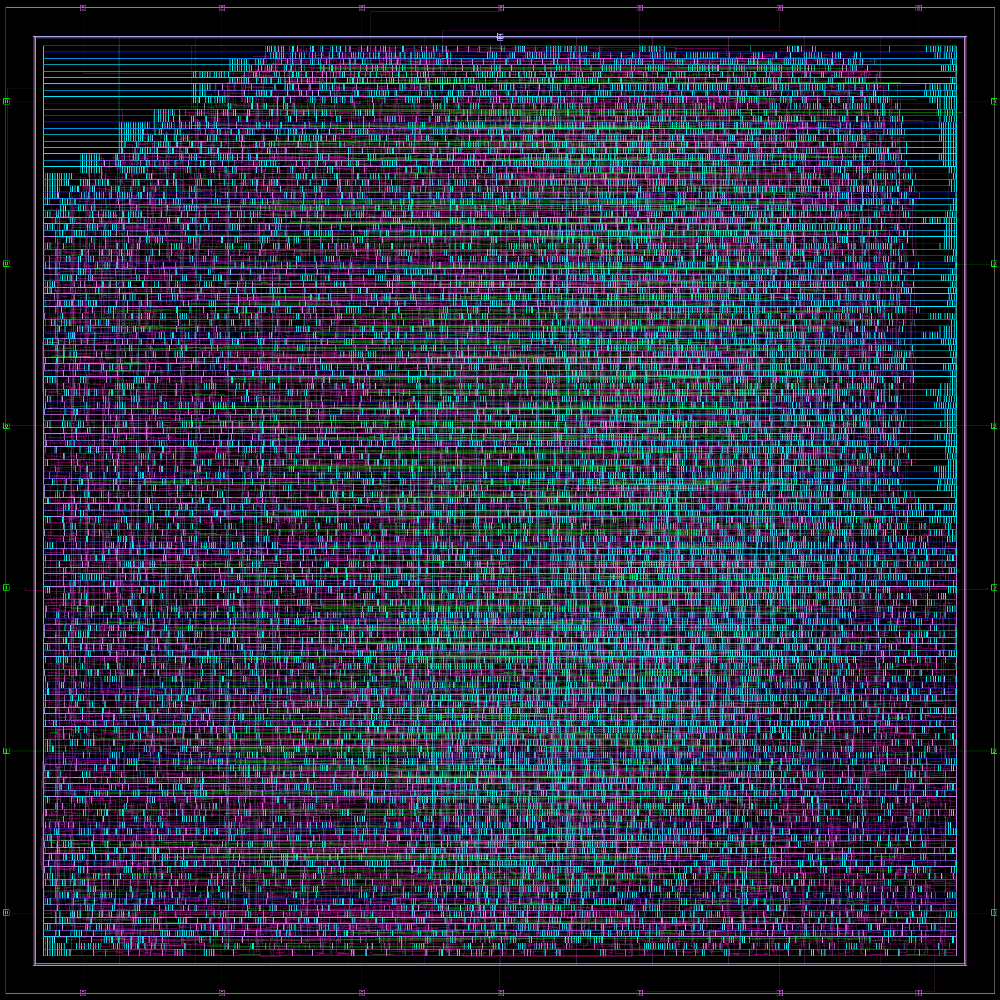

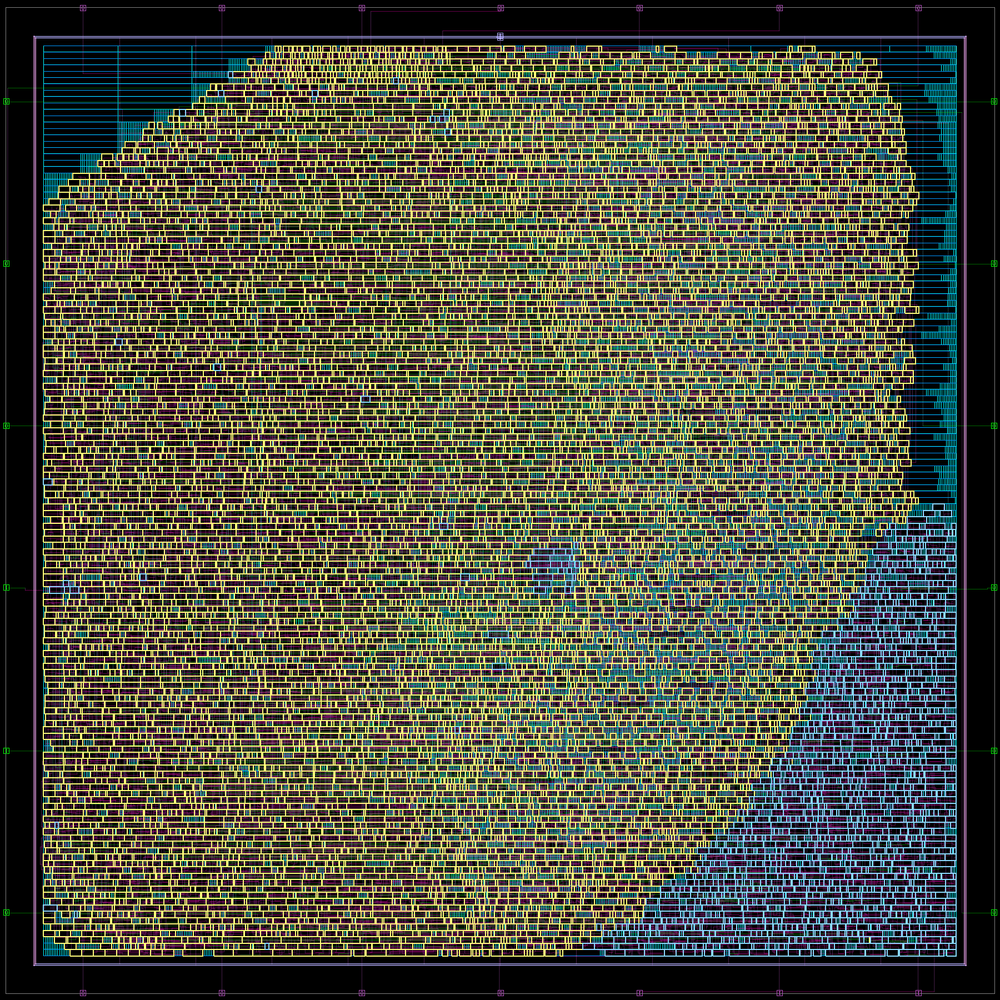

O FIR ocupa a maior parte do core. Isso é coerente com a análise de potência, em que o FIR responde por 86,7% do total.

## Simulações (VCS + Verdi)

Script das formas de onda: [`imagens/scripts/sim_ondas.sh`](../imagens/scripts/sim_ondas.sh). Ele simula numa cópia da tag `v1.0-tcc`, e todos os testes usados nas imagens foram aprovados contra o Golden Model.

- **RTL:** `onda_rtl_<teste>`.
- **Pós-layout:** netlist final com o SDF do PrimeTime (corner tt0p85v25c, parasitas Cmax).

### Resposta em frequência: varredura de 0 a 150 kHz (teste 09)

A entrada é um chirp linear: a frequência cresce 75 kHz por milissegundo. Como a saída chega cerca de 0,11 ms depois da entrada (latência de 33 amostras), a frequência no instante *t* da imagem é aproximadamente **f ≈ 75 kHz/ms × (t − 0,11 ms)**. A envoltória da curva é a própria resposta em frequência do filtro:

| Tempo na imagem | Frequência | Região |
|---|---|---|
| ~0,11 a ~1,18 ms | 0 a 80 kHz | banda útil: amplitude constante |
| ~1,18 a ~1,58 ms | 80 a 110 kHz | transição (−3 dB medido em 90,6 kHz, ~1,32 ms) |
| depois de ~1,58 ms | acima de 110 kHz | rejeição: saída praticamente nula |

| RTL | Pós-layout com SDF |
|---|---|
| [s01_varredura_rtl.png](imagens/simulacao/s01_varredura_rtl.png) | [s02_varredura_pos_layout.png](imagens/simulacao/s02_varredura_pos_layout.png) |

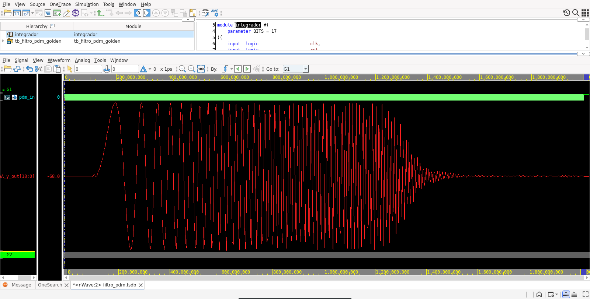

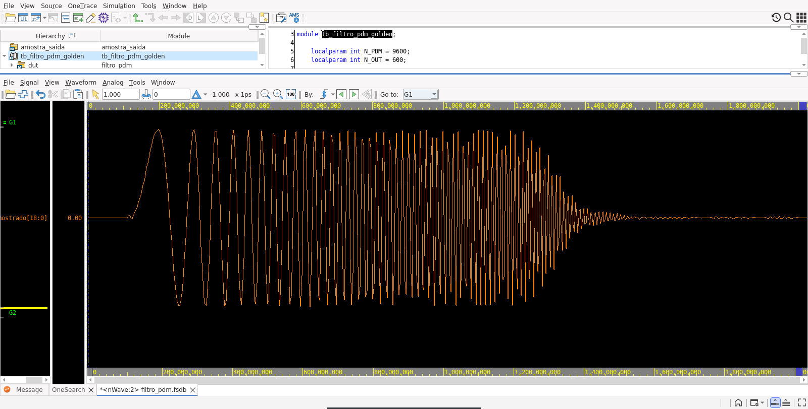

As duas curvas são iguais: o chip final, com os atrasos reais do layout, filtra como o RTL.

Na imagem pós-layout, a curva é `amostra_saida.y_amostrado`. É o valor de `y_out` na borda de descida do clock com `valid_out = 1`, o mesmo instante em que o testbench compara a saída com o Golden Model ([`imagens/sim/amostra_saida.sv`](../imagens/sim/amostra_saida.sv)). A forma analógica do próprio `y_out` pós-layout mostraria picos verticais nas trocas de valor, porque os bits mudam em instantes ligeiramente diferentes (ver s09).

### Rejeição de interferência: 50 kHz + 130 kHz (teste 08)

| Imagem | Simulação | Trecho |
|---|---|---|
| [s03_interferencia_130k.png](imagens/simulacao/s03_interferencia_130k.png) | RTL | 800 a 950 µs |
| [s10_interferencia_pos_layout.png](imagens/simulacao/s10_interferencia_pos_layout.png) | pós-layout com SDF | 800 a 950 µs |

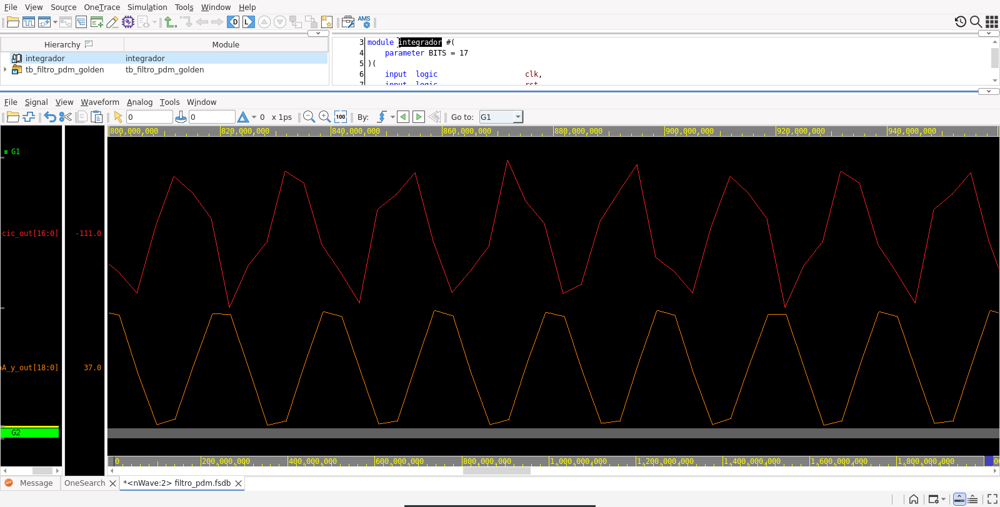

Em cima, `cic_out` (saída do CIC, entrada do FIR): os 50 kHz com a interferência de 130 kHz somada, o que dá picos de alturas diferentes. Embaixo, `y_out`: só os 50 kHz, com ciclos regulares. A rejeição medida a 130 kHz é de pelo menos 104,4 dB ([desempenho_filtro.md](desempenho_filtro.md)).

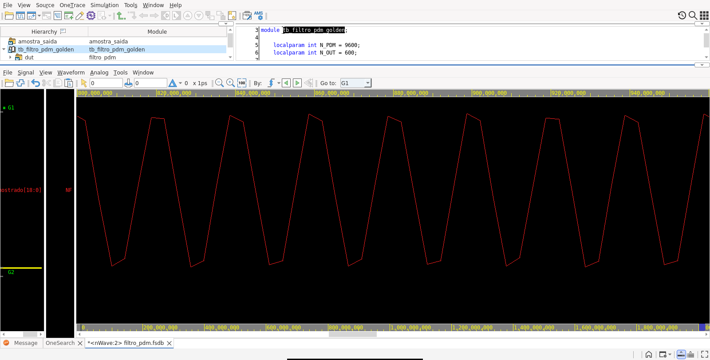

No pós-layout, a saída amostrada é igual ao `y_out` do RTL.

### Resposta ao impulso (teste 10)

[s04_impulso.png](imagens/simulacao/s04_impulso.png): trecho de 700 a 890 µs.

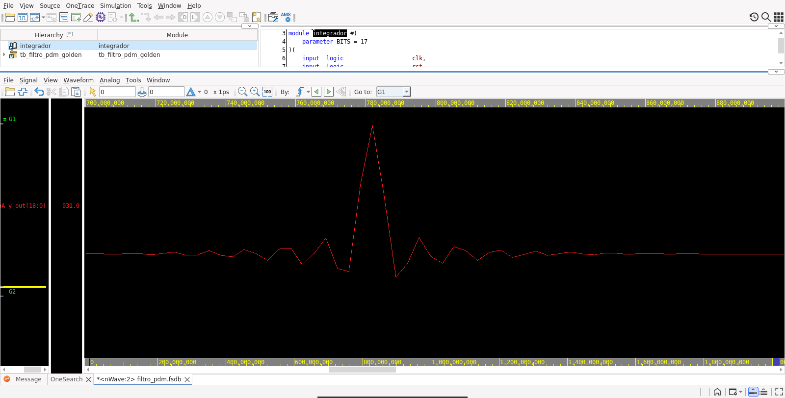

A entrada é a sequência 0101… (média zero) com um único bit invertido. A saída mostra a resposta ao impulso do CIC + FIR: um pico central (por volta de 780 µs, que é o instante do bit invertido mais a latência) e lóbulos laterais simétricos, característicos de um FIR de fase linear.

### Senoides na banda útil (testes 01, 03 e 04)

| Imagem | Frequência | Trecho |
|---|---|---|
| [s05_seno_10k.png](imagens/simulacao/s05_seno_10k.png) | 10 kHz | teste inteiro (2 ms, 20 ciclos) |
| [s06_seno_50k.png](imagens/simulacao/s06_seno_50k.png) | 50 kHz | 800 a 1.040 µs |
| [s07_seno_80k.png](imagens/simulacao/s07_seno_80k.png) | 80 kHz | 800 a 1.040 µs |

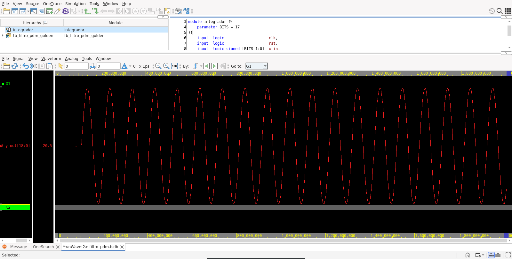

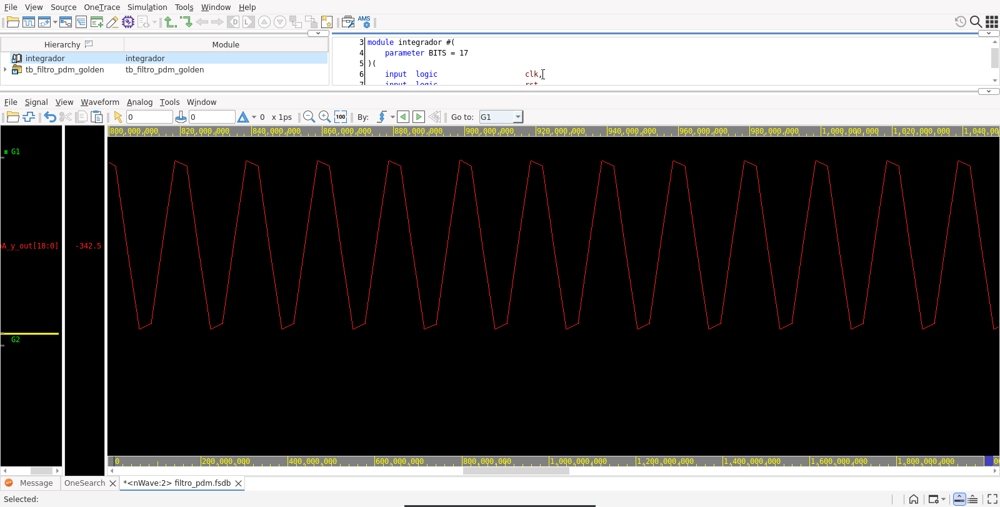

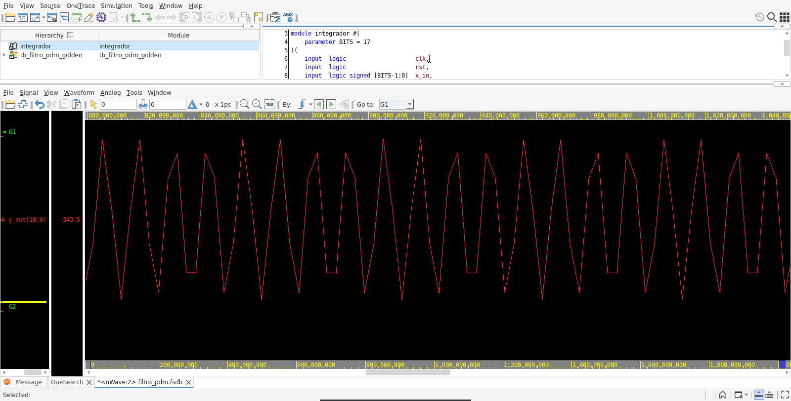

As três senoides saem com a mesma amplitude: 80 kHz ainda está dentro da banda útil.

O aspecto poligonal das curvas é real. A saída tem 300 mil amostras por segundo, e o Verdi liga as amostras com retas. Uma senoide de 50 kHz tem 6 amostras por ciclo, e uma de 80 kHz tem 3,75, por isso os picos desta última parecem ter alturas diferentes. As amostras em si conferem uma a uma com o Golden Model.

### Funcionamento ciclo a ciclo

[s08_detalhe_decimacao.png](imagens/simulacao/s08_detalhe_decimacao.png): RTL, teste 03, trecho de 500 a 512 µs.

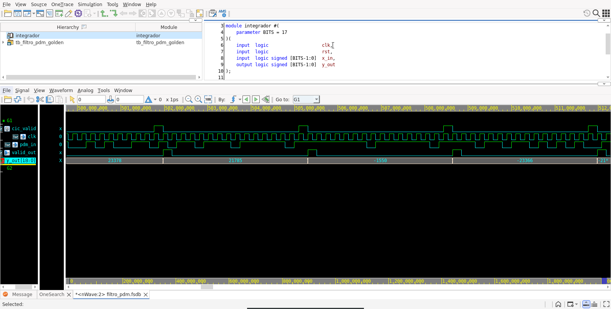

O CIC entrega uma amostra (`cic_valid`) a cada 16 ciclos de `clk`, decimando de 4,8 MHz para 300 kHz. O FIR sinaliza a saída (`valid_out`) um ciclo depois, e `y_out` muda a cada nova amostra.

[s09_atraso_pos_layout.png](imagens/simulacao/s09_atraso_pos_layout.png): pós-layout com SDF, teste 09, trecho de cerca de 5 ns em torno de uma borda de subida do clock.

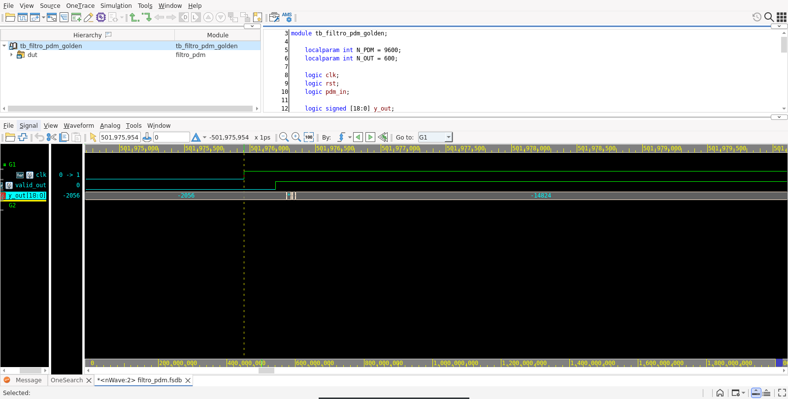

Com os atrasos reais das células e dos fios, as saídas mudam uma fração de nanossegundo depois da borda do clock. Pela régua da imagem:
- `valid_out` sobe cerca de 0,24 ns depois do clock;
- `y_out` começa a mudar por volta de 0,32 ns e estabiliza em cerca de 0,40 ns.

Os valores curtos intermediários são os bits do barramento chegando em instantes diferentes. Esses atrasos são muito menores que o período de 208 ns, o que é coerente com a folga de setup de +60 ns no corner tt.
